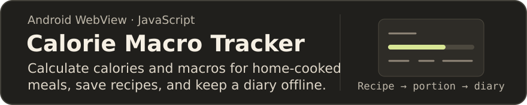
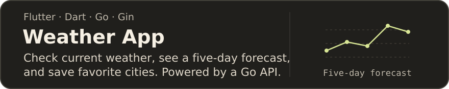
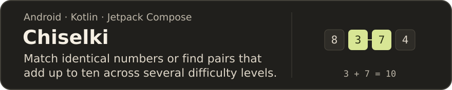
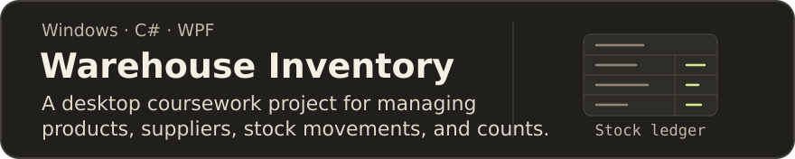
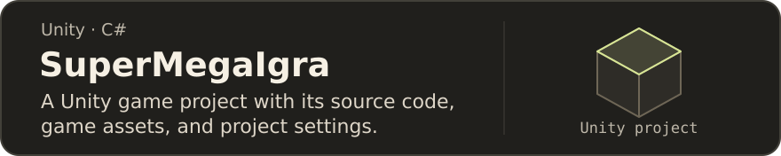

## About me

I’m **D3R3j**. I build Android apps, write Go backends, and experiment with desktop tools and games in C#. My projects range from an offline food diary for home cooking to a number puzzle built with Jetpack Compose.

## Repositories

[Download the APK](https://github.com/D3R3j/calorie-macro-tracker/releases/latest/download/calorie-macro-tracker.apk) · [Release notes](https://github.com/D3R3j/calorie-macro-tracker/releases/latest)

[Browse all repositories](https://github.com/D3R3j?tab=repositories)
