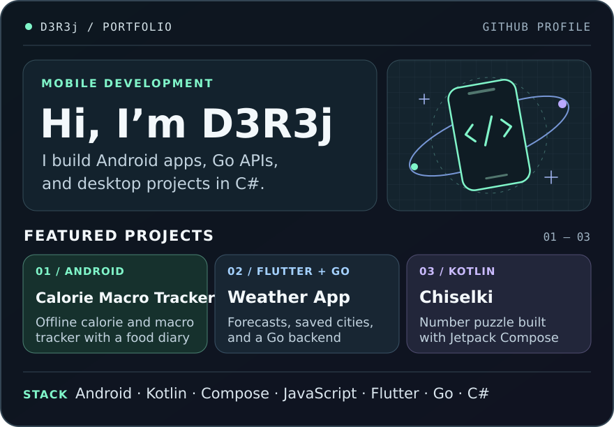

  

  <a href="https://github.com/D3R3j/calorie-macro-tracker/releases/latest/download/calorie-macro-tracker.apk"><strong>Download APK</strong></a> ·
  <a href="https://github.com/D3R3j/calorie-macro-tracker">Calorie Macro Tracker</a> ·
  <a href="https://github.com/D3R3j/weather-app">Weather App</a> ·
  <a href="https://github.com/D3R3j/MobileApp_Chiselki">Chiselki</a>

More C# projects

- [Warehouse Inventory](https://github.com/D3R3j/Kursovaya_DuzhikIlya) — WPF coursework project for managing products, suppliers, and stock counts.
- [SuperMegaIgra](https://github.com/D3R3j/SuperMegaIgra) — a game project built with Unity.

