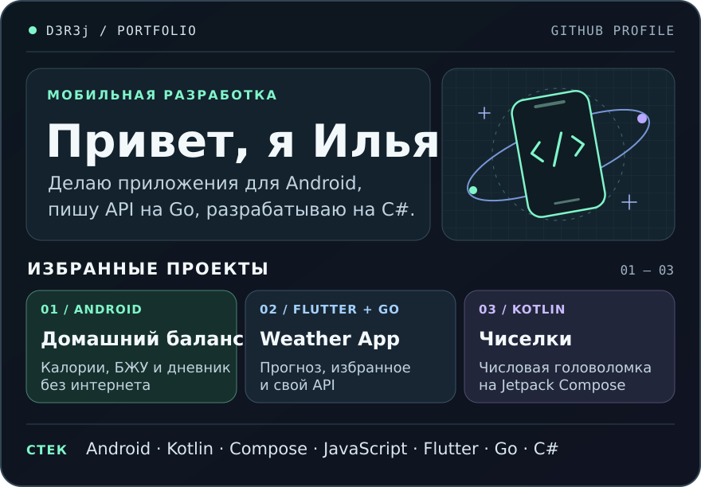

  

  <a href="https://github.com/D3R3j/calorie-macro-tracker/releases/latest/download/calorie-macro-tracker.apk"><strong>Скачать APK</strong></a> ·
  <a href="https://github.com/D3R3j/calorie-macro-tracker">Домашний баланс</a> ·
  <a href="https://github.com/D3R3j/weather-app">Weather App</a> ·
  <a href="https://github.com/D3R3j/MobileApp_Chiselki">Чиселки</a>

Ещё проекты на C#

- [Складской учёт](https://github.com/D3R3j/Kursovaya_DuzhikIlya) — курсовой проект на WPF с учётом товаров, поставщиков и инвентаризации.
- [SuperMegaIgra](https://github.com/D3R3j/SuperMegaIgra) — игровой проект на Unity.

