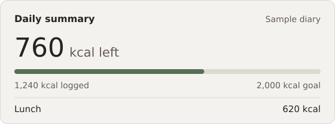

# D3R3j

I build Android apps, write Go APIs, and make desktop tools in C#.

## Selected projects

### [Calorie Macro Tracker](https://github.com/D3R3j/calorie-macro-tracker)

An offline Android app for logging home-cooked meals. It calculates calories and macros from ingredients and portion sizes.

[Download the Android APK](https://github.com/D3R3j/calorie-macro-tracker/releases/latest/download/calorie-macro-tracker.apk) · [View source](https://github.com/D3R3j/calorie-macro-tracker)

### [Weather App](https://github.com/D3R3j/weather-app)

A Flutter app for checking the five-day forecast and saving favorite cities. A Go backend fetches the weather data.

### [Chiselki](https://github.com/D3R3j/MobileApp_Chiselki)

An Android number puzzle built with Kotlin and Jetpack Compose. Find matching numbers and pairs that add up to ten.

**Tools I use:** Kotlin, Jetpack Compose, JavaScript, Flutter, Go, and C#.

More C# projects

- [Warehouse Inventory](https://github.com/D3R3j/Kursovaya_DuzhikIlya) is a WPF coursework project for managing products, suppliers, and stock counts.
- [SuperMegaIgra](https://github.com/D3R3j/SuperMegaIgra) is a game project built with Unity.

