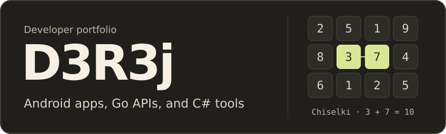

## Selected projects

| Project | What it does |
| :--- | :--- |
| **[Calorie Macro Tracker](https://github.com/D3R3j/calorie-macro-tracker)** | An offline food diary for home-cooked meals. Calculates calories and macros from ingredients and portions. [Download APK](https://github.com/D3R3j/calorie-macro-tracker/releases/latest/download/calorie-macro-tracker.apk) |
| **[Weather App](https://github.com/D3R3j/weather-app)** | Five-day forecasts and favorite cities, with a Flutter client and a Go backend. |
| **[Chiselki](https://github.com/D3R3j/MobileApp_Chiselki)** | A number puzzle in Kotlin and Jetpack Compose. Find matching numbers or pairs that add up to ten. |

Kotlin · Jetpack Compose · JavaScript · Flutter · Go · C#

More C# projects

- [Warehouse Inventory](https://github.com/D3R3j/Kursovaya_DuzhikIlya) — WPF coursework for managing products, suppliers, and stock counts.
- [SuperMegaIgra](https://github.com/D3R3j/SuperMegaIgra) — a game project built with Unity.

